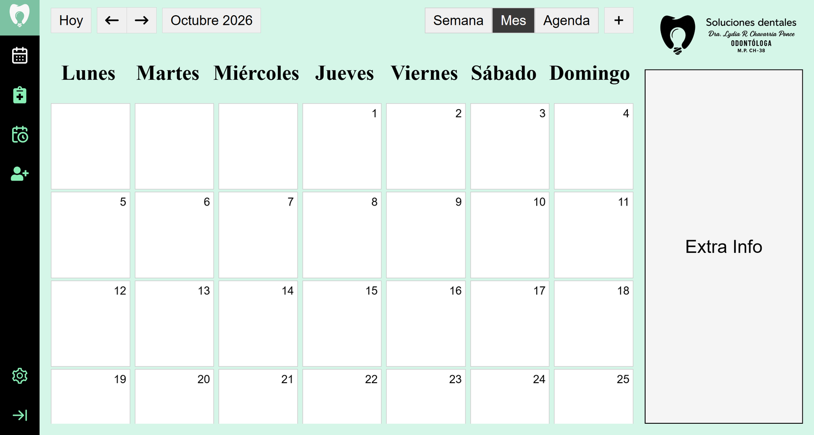
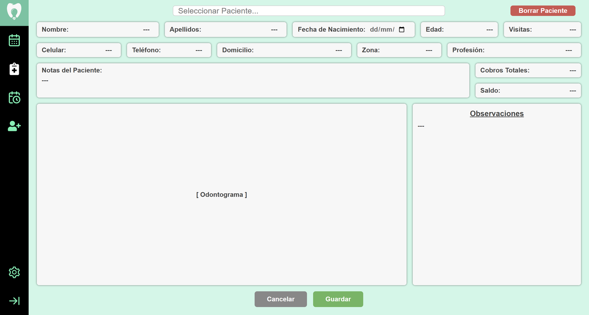

# Dentist System

A practice management app I'm building for a friend who runs a dental practice. Their patient records, appointments and billing notes currently live on paper, and the goal is to move them into a clear, easy-to-use interface that the whole practice can rely on. The interface is in Spanish.

**Status:** still under construction, roughly halfway. The appointments page is next.

<table>
  <tr>
    <td width="33%"> Welcome screen after login</td>
    <td width="33%"> Calendar, month view</td>
    <td width="33%"> Patient record (Ficha Clínica)</td>
  </tr>
</table>

## What it does

- **Login.** Staff sign in through Supabase Auth, and every page redirects to the login screen when there's no active session.
- **Calendar.** Organizes the practice's appointments in month, week and agenda views.
- **Patient record (Ficha Clínica).** Search for a patient and manage everything the practice needs in one place: personal and contact details, notes, billing totals and balance, and an odontogram (tooth chart), with changes saved to the database. Age is calculated from the date of birth instead of being stored.
- **Appointments (Citas).** Schedule appointments and search them by date.
- **New patients.** Add patients to the system.

## How it's built

React frontend and Express API, both backed by the same Supabase PostgreSQL database.

- **Two data paths.** The frontend talks to Supabase directly for authentication, and to the Express API for patient data, which runs parameterized SQL through `pg`.
- **A light list for search, full records on demand.** The app loads a minimal patient list (ID, name and phone numbers) to power the search box, and shares it with every page through React Router's outlet context. A patient's full record is only fetched when you select them, and newly added patients are added to the list without reloading it. This keeps the app responsive as the number of patients grows.

**Tech:** React 19, React Router 7, Supabase (Auth and PostgreSQL), Express 5, Node.js, `pg`.

Built for the practice's private use, so it isn't publicly deployed. The repo is here to showcase the code.
